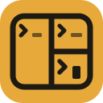
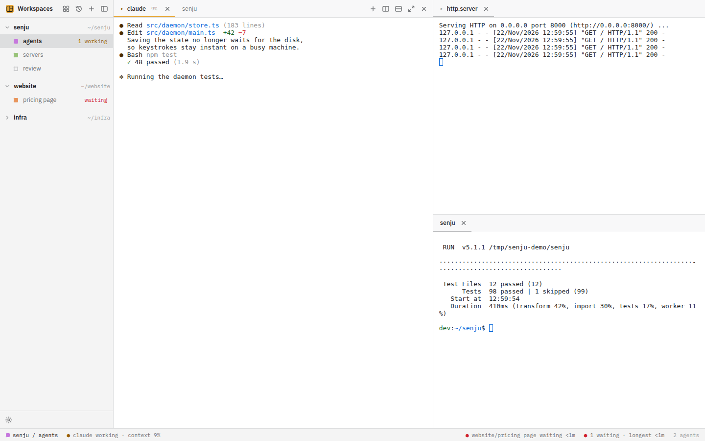
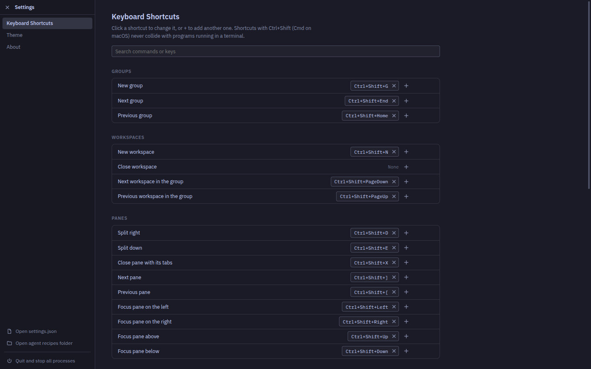
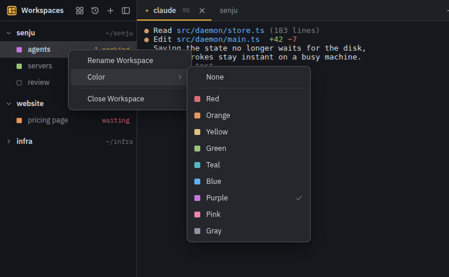

<p align="center"></p>

<h1 align="center">Senju</h1>

<p align="center"><b>The IDE for multitasking in the age of AI.</b><br>
A terminal that keeps many projects and AI agents running side by side — and brings all of them back after a reboot.</p>

<p align="center">
  <a href="LICENSE"></a>
  
  
</p>


Senju (千手, "a thousand hands") is for the way people work with coding agents: one agent refactoring, another writing tests, a dev server and a log in the corner, across several projects at once. It keeps every project in a **group**, every task in a **workspace**, splits each workspace into **panes** with their own **tabs**, and shows at a glance which agents are working and which are waiting for you.

Close the window, crash it, update it or reboot the computer: the layout, the tabs, the working directories and the scrollback come back, and Claude Code and other agents continue the same conversations. Senju is inspired by [cmux](https://github.com/manaflow-ai/cmux), keeps only the essentials, and treats Linux as a first-class platform.

## Features

**Organise many projects and agents**

- Groups in the sidebar, one per project, each with a list of workspaces and its own default folder.
- Workspaces split horizontally and vertically into panes with any nesting; every pane has its own tabs.
- Colors for workspaces, drag and drop for groups, workspaces and tabs (also between panes), inline renaming.
- A collapsible sidebar that shrinks to a rail of workspace markers.

**See what your agents are doing**

- Every agent is marked **working** while it prints output and **waiting** once it has been quiet for a second and a half and needs you. What it shows in reply to your typing or a resize does not count as work.
- The sidebar shows the state per workspace, tabs mark it with ▸, and the status bar lists the agents of the current workspace and every other workspace that waits for input — click one to jump there.

**Never lose a session**

- Terminals live in a background service, so closing or updating the window does not stop them.
- After a reboot, groups, workspaces, layout, tabs, working directories and scrollback are restored.
- Agents resume their own sessions — Claude Code with `claude --resume <id>`, one session per tab, even with several agents in one folder. Recipes for Codex CLI, Gemini CLI, OpenCode, Aider and Neovim sessions are included as well (less tested than Claude Code so far), and new agents are added with a small JSON [recipe](#agent-recipes).
- Dev servers, log followers and monitors start again on their own; any other command offers a **Run again** button.

**Make it yours**

- Nine built-in themes plus your own, with every terminal color and the font editable and a live preview.
- Every keyboard shortcut can be changed, and the defaults never take keys that vim, tmux or an agent need.
- Menus, dialogs and pickers are drawn by the app, so the whole window follows the theme.

<table>
  <tr>
    <td width="50%"><br><sub>Every theme styles the whole window, light ones included.</sub></td>
    <td width="50%"><br><sub>Built-in themes, custom themes and fonts.</sub></td>
  </tr>
  <tr>
    <td width="50%"><br><sub>Every shortcut can be changed.</sub></td>
    <td width="50%"><br><sub>Workspace colors and context menus.</sub></td>
  </tr>
</table>

## Install

On Linux and macOS, run:

```sh
curl -fsSL https://raw.githubusercontent.com/illerax/senju/main/install.sh | sh
```

The script installs the latest [release](https://github.com/illerax/senju/releases/latest) without root access, and running it again updates Senju:

- **Linux** (x86_64): the AppImage goes to `~/.local/bin/senju`, with an entry in the applications menu. AppImages need FUSE 2 (`sudo apt install libfuse2t64` on Ubuntu 24.04+).
- **macOS** (Apple silicon and Intel): `Senju.app` goes to `/Applications`. The app is not code-signed yet; the script clears the quarantine flag so macOS opens it.

Pass options after `sh -s --`: `--version 0.1.1` installs a given version, `--uninstall` removes the app. Neither touches your settings, state or running terminals.

You can also download the installers from the [releases page](https://github.com/illerax/senju/releases/latest): the AppImage or a deb package for Linux, a dmg for macOS, and an installer for Windows.

## Building from source

You need:

- **Node.js 22** or newer
- a **C/C++ toolchain** for [node-pty](https://github.com/microsoft/node-pty): `build-essential` and `python3` on Debian/Ubuntu, the Xcode command line tools on macOS, Visual Studio Build Tools on Windows

Run it:

```sh
git clone <this repository>
cd senju
npm install
npm start
```

Build installable packages — AppImage and deb on Linux, dmg on macOS, an NSIS installer on Windows — into `release/`:

```sh
npm run dist
```

> **Note for Ubuntu 24.04 and later.** These releases restrict the user namespaces Electron's sandbox needs, so `npm start` runs Electron with `--no-sandbox`. To run from source with the sandbox, give its helper the expected permissions and start with `npx electron .`:
>
> ```sh
> sudo chown root node_modules/electron/dist/chrome-sandbox
> sudo chmod 4755 node_modules/electron/dist/chrome-sandbox
> ```

## Using Senju

Create a group with **+** at the top of the sidebar; it starts in your home folder with one workspace. The path next to a group's name is where its new workspaces open — change it with **Change Default Path…** in the group's context menu. Add workspaces with the **+** that appears on the group's row.

- Each pane's tab bar has buttons to add a tab, split the pane right or down, and close the pane with all its tabs. New tabs and splits start in the folder of the terminal they come from.
- Double-click a group, workspace or tab to rename it. A tab without a name shows its running program or folder.
- Right-click a workspace for its **Color**, a group for its folder, a terminal for copy, paste and splits.
- Drag the line between panes to resize them.
- Ctrl+mouse wheel (Cmd+wheel or a pinch on macOS) zooms the text of the tab under the pointer; so do the tab zoom shortcuts below for the focused tab. Other shortcuts zoom all terminals, and a tab's own zoom adds to that. While the focused tab is zoomed, the status bar shows its zoom; click it to return the tab to the font's own size. A terminal's context menu has **Reset Tab Zoom** and **Reset Zoom of All Terminals**. Both zooms are kept across restarts.
- Select text with the mouse; on Linux it also goes to the primary selection, and a middle click pastes it. Ctrl+click (Cmd+click on macOS) opens a link in the browser, including links that programs print with a different text (OSC 8 hyperlinks); hovering one shows its address.
- Exiting a shell closes its tab; the last tab closes its pane, and the last pane its workspace.

Closing the window only closes the UI: every terminal keeps running and is there when you open Senju again. To stop everything, use **Quit and stop all processes** at the bottom of the settings; the next start restores the terminals as after a reboot.

### Keyboard shortcuts

Change any of them in **Settings → Keyboard Shortcuts** (the gear at the bottom of the sidebar).

| Action | Linux, Windows | macOS |
| --- | --- | --- |
| New group | Ctrl+Shift+G | Cmd+Shift+N |
| Next / previous group | Ctrl+Shift+End / Home | Cmd+Ctrl+Down / Up |
| New workspace in the current group | Ctrl+Shift+N | Cmd+N |
| Next / previous workspace, across groups | Ctrl+Shift+PageDown / PageUp | Cmd+Shift+Down / Up |
| Move workspace down / up, into the next or previous group at the ends | Ctrl+Alt+Shift+PageDown / PageUp | Cmd+Alt+Shift+Down / Up |
| Split right / down | Ctrl+Shift+D / E | Cmd+D / Cmd+Shift+D |
| Close pane with its tabs | Ctrl+Shift+X | Cmd+Shift+W |
| Next / previous pane | Ctrl+Shift+] / [ | Cmd+] / [ |
| Focus pane in a direction | Ctrl+Shift+Arrows | Cmd+Alt+Arrows |
| New terminal tab | Ctrl+Shift+T | Cmd+T |
| Close terminal tab | Ctrl+Shift+W | Cmd+W |
| Rename tab | Ctrl+Shift+R | Cmd+Shift+R |
| Next / previous tab | Ctrl+Tab / Ctrl+Shift+Tab | Ctrl+Tab, Cmd+Shift+] / [ |
| Tab 1–9 | Ctrl+Shift+1…9 | Cmd+1…9 |
| Copy / paste | Ctrl+Shift+C / V, Shift+Insert | Cmd+C / V |
| Show / hide the sidebar | Ctrl+Shift+B | Cmd+B |
| Settings | Ctrl+Shift+, | Cmd+, |
| Zoom the tab in / out | Ctrl+Shift+= / - | Cmd+= / - |
| Reset the zoom of the tab | Ctrl+Shift+0 | Cmd+0 |
| Zoom all terminals in / out | Ctrl+Alt+Shift+= / - | Cmd+Alt+= / - |
| Reset the zoom of all terminals and tabs | Ctrl+Alt+Shift+0 | Cmd+Alt+0 |

"Close workspace" has no default shortcut. Switching to another group returns to the workspace you last used there.

### Themes and fonts

**Settings → Theme** offers Senju Dark, Tokyo Night, Catppuccin Mocha, Dracula, Nord, Gruvbox Dark, Solarized Dark and Light, and GitHub Light. **New theme from selected** copies the current theme into a custom one, where the background, foreground, cursor, selection and all 16 ANSI colors can be edited, and where the theme can have its own font: family, size, weight and line height. The default font on the same page is used by every theme that has none of its own. The family field takes any CSS font list; the arrow next to it lists your installed monospace fonts.

## How restore works

The terminals run in a background service, not in the window. It saves the workspace structure to a small JSON file after every change and each terminal's scrollback to a file of its own every 15 seconds (every minute for terminals that keep printing, and always on shutdown), always atomically, so a crash or power loss never corrupts them.

The structure — groups, workspaces, layout, tabs, focus, folders and scrollback — always comes back. Running programs come back at the best of three levels:

1. **The process keeps running.** Closing or updating the window does not touch the service, so programs simply continue. This does not survive a reboot.
2. **The agent resumes its session.** An agent recognised by a recipe starts again with its session, keeping its options (but not an initial prompt) and its environment, such as `CLAUDE_CONFIG_DIR`. Several agents in one folder each get their own session back. An agent you closed yourself stays closed.
3. **The command starts again** in the same folder with the same environment. Commands matching the `autoRestart` list (dev servers, `tail -f`, log followers, monitors) restart on their own; others show a **Run again** button.

When Senju is updated while the service is still running the previous version, a banner offers **Restart service**, which applies the update and restores the terminals as after a reboot.

## Updates

Installed builds look for a new release at start and every four hours (turn this off in **Settings → About**). When one appears, a banner offers **Download and install**; nothing is downloaded or installed until you agree. Once it is downloaded, **Restart and install** replaces the app and starts the new version, or it is installed the next time you quit.

- Your settings, state and scrollback live in your own folders (see [Configuration](#configuration)), so an update never touches them; older state files are migrated.
- Running terminals keep running: the background service is not stopped by the update. On Windows, macOS and for the AppImage it runs from its own copy of the app, outside the install folder, because the Windows installer closes a running Senju, an AppImage disappears when it is replaced, and a replaced app on macOS would hand the service the new version's files. After the update the new version reconnects to the service; if the service runs an older build, a banner offers to restart it when it suits you.
- If a new version cannot work with the running service at all, Senju asks before restarting it, and you can keep the old version running instead.
- AppImage, macOS and the Windows installer update themselves; the deb package asks for your password to install. The macOS app is not code-signed, so it does what the install script does: it downloads the disk image, copies the new app next to the installed one and swaps them. When Senju cannot replace itself — macOS runs it from a temporary copy (open it from Applications instead) or its folder is not writable — the banner opens the release page.

## Configuration

Settings live in `settings.json`, which holds only what differs from the defaults (**Open settings.json** at the bottom of the settings). Every key is optional:

| Key | Default | Description |
| --- | --- | --- |
| `fontFamily`, `fontSize`, `fontWeight`, `lineHeight` | JetBrains Mono, 13, 400, 1 | Default terminal font. |
| `zoom` | `0` | Pixels added to the font size of every terminal by zooming all terminals; a tab's own zoom is kept with the workspaces. |
| `theme` | `Senju Dark` | Name of a built-in or custom theme. |
| `themes` | `{}` | Custom themes by name: `background`, `foreground`, `cursor`, `selectionBackground`, the 16 ANSI colors (`black` … `brightWhite`) and optionally `font`. |
| `keybindings` | `{}` | Shortcuts that differ from the defaults, e.g. `{ "newTab": ["Ctrl+Alt+T"] }`; an empty list unbinds a command. |
| `shell`, `shellArgs` | `$SHELL` (PowerShell on Windows) | Shell for new terminals. macOS starts a login shell by default. |
| `scrollback` | `10000` | Lines kept per terminal while running. |
| `persistedScrollback` | `5000` | Lines saved per terminal and restored after a reboot. |
| `autoRestart` | dev servers, log followers, monitors | Regular expressions for command lines that restart automatically after a reboot. |
| `copyOnSelect` | `false` | Copy selected text to the clipboard. |

Changes in the settings page apply right away; edits to the file apply when the app starts. `shell`, `scrollback`, `autoRestart` and recipes are read by the background service when it starts.

| | Linux | macOS | Windows |
| --- | --- | --- | --- |
| Settings, recipes | `~/.config/senju/` | `~/Library/Application Support/Senju/` | `%APPDATA%\Senju\` |
| State, scrollback, log | `~/.local/state/senju/` | same as above | same as above |

`SENJU_HOME` replaces all of these with one folder, which is handy for testing.

## Agent recipes

A recipe tells Senju how to recognise an agent, how to find its session id and how to reopen it. The built-in ones are in [`recipes/`](recipes). To add an agent or change a built-in one, put a JSON file into the recipes folder (**Open agent recipes folder** at the bottom of the settings); a recipe with the name of a built-in one replaces it.

```json
{
  "name": "claude-code",
  "match": "^claude$|@anthropic-ai/claude-code",
  "session": {
    "args": ["(?:--resume|-r|--session-id)[ =]([0-9a-f-]{36})"],
    "pidFile": { "file": "${env:CLAUDE_CONFIG_DIR:-~/.claude}/sessions/${pid}.json", "field": "sessionId" },
    "files": { "dir": "${env:CLAUDE_CONFIG_DIR:-~/.claude}/projects/${cwdSlug}", "pattern": "^([0-9a-f-]{36})\\.jsonl$" }
  },
  "flags": { "drop": ["--resume", "-r", "--continue", "-c"], "withValue": ["--resume", "-r", "--model"] },
  "resume": "claude ${flags} --resume ${sessionId}",
  "fallback": "claude ${flags} --continue"
}
```

| Field | Meaning |
| --- | --- |
| `match` | Regular expression for the program name or path. Programs run by an interpreter (`node`, `python`, …) are matched by their script. |
| `requires` | A file relative to the working folder that must exist, e.g. `Session.vim`. |
| `session.args` | Regular expressions over the arguments; group 1 is the session id. |
| `session.pidFile` | A JSON file the agent writes per process; `field` holds the session id. The most precise source. |
| `session.files` | A folder with one file per session; `pattern` group 1 is the id. Options: `recursive`, `newestDirs` (only the last N subfolders by name) and `contains` (text that must appear at the start of the file). Used when there is no `pidFile`: each terminal takes the newest unclaimed session file written after its agent started. |
| `flags` | Which original options `${flags}` carries over: everything starting with `-` except `drop`; `withValue` lists options followed by a separate value. Positional arguments are never carried over. |
| `resume` | Command for a known session. |
| `fallback` | Command when the session id is unknown. |

Templates understand `${sessionId}`, `${flags}`, `${args}`, `${program}`, `${cwd}`, `${cwdSlug}` (the folder with every non-alphanumeric character replaced by `-`), `${cwdJson}`, `${pid}`, `${home}`, `${env:NAME}` and `${env:NAME:-default}`; a leading `~` is the home folder.

## Platform notes

- **Linux** (X11 and Wayland) is the primary platform and supports everything above.
- **macOS** supports everything, except that a program's environment cannot be read, so restored programs get the shell's environment.
- **Windows** does not expose a terminal's foreground program or folder, so programs are not resumed or restarted after a reboot; the layout, tabs and scrollback are restored, and terminals start in their initial folder.

## Development

```sh
npm run build        # bundle into dist/
npm run typecheck
npm test             # unit tests
npm run test:daemon  # end-to-end test of the background service: terminals, jobs, agents, restore
npm run test:ui      # drives the app with Playwright and saves screenshots to ui-smoke/
npm run test:perf    # keystroke latency under heavy output, switching times
npm run test:network # a network share and an update server on a bad connection (Linux, needs fusermount3)
npm run screenshots  # regenerates the README screenshots in docs/screenshots/
npm run icons        # renders build/icon.svg into the app icons
node scripts/update-e2e.mjs <old.AppImage> <dir>  # self-update test, see the script
```

The code is split by process:

- `src/daemon` — the background service: owns the pseudo terminals (node-pty), mirrors each into a headless xterm for scrollback, tracks folders, programs and agent sessions, and saves the state.
- `src/main` — the Electron main process: starts or connects to the service and relays messages.
- `src/renderer` — the UI: sidebar, pane layout, tabs, xterm.js terminals, settings, menus and dialogs.
- `src/shared` — state types, the protocol, layout operations, commands, settings and themes.
- `recipes` — built-in agent recipes.

## Releases and versioning

Releases follow [semantic versioning](https://semver.org). The version is decided by what someone who updates notices, not by how big the change is:

| Bump | When | Examples |
| --- | --- | --- |
| **major** | Something stops working as before without the user doing anything | `state.json` from an older version is not read and has no migration; a `settings.json` key or the recipe format changes incompatibly; a feature or platform is removed; a default shortcut people rely on changes |
| **minor** | Something new, and everything old works as before | a new command, setting, theme or agent recipe; a new state field with an automatic migration; a protocol change that makes the update restart the background service |
| **patch** | Fixed or faster, nothing new | a bug fix, a performance gain, layout or wording |
| none | Nothing reaches users | tests, CI, refactoring, documentation |

While the version is below 1.0, a breaking change bumps the minor version and a feature the patch version. 1.0.0 is released by hand once the data and settings formats are stable.

The bump is computed from [Conventional Commits](https://www.conventionalcommits.org). Pull requests are squash-merged, so the PR title is the commit message, and CI checks it:

- `feat: …` → minor, `fix: …` and `perf: …` → patch
- `feat!: …`, or a `BREAKING CHANGE:` paragraph in the PR description → major
- `docs:`, `test:`, `ci:`, `build:`, `refactor:`, `chore:`, `style:` → no release

After each merge, [release-please](https://github.com/googleapis/release-please) updates a `chore: release x.y.z` pull request with the new version and changelog. Merging it tags the version, creates the GitHub release and attaches the installers for Linux (AppImage, deb), macOS (dmg, Apple silicon and Intel) and Windows (installer), built by CI. The release stays a pre-release until all installers are attached, so installed apps and the install command only see it once there is something to install. The installers are not code-signed yet, so macOS and Windows warn on first start.

## License

[MIT](LICENSE)
