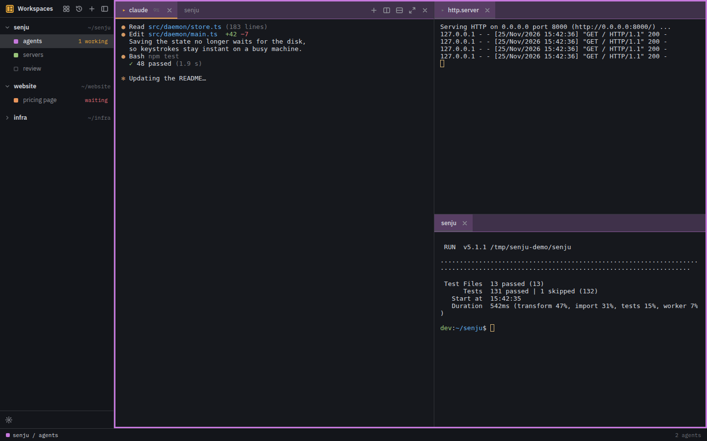
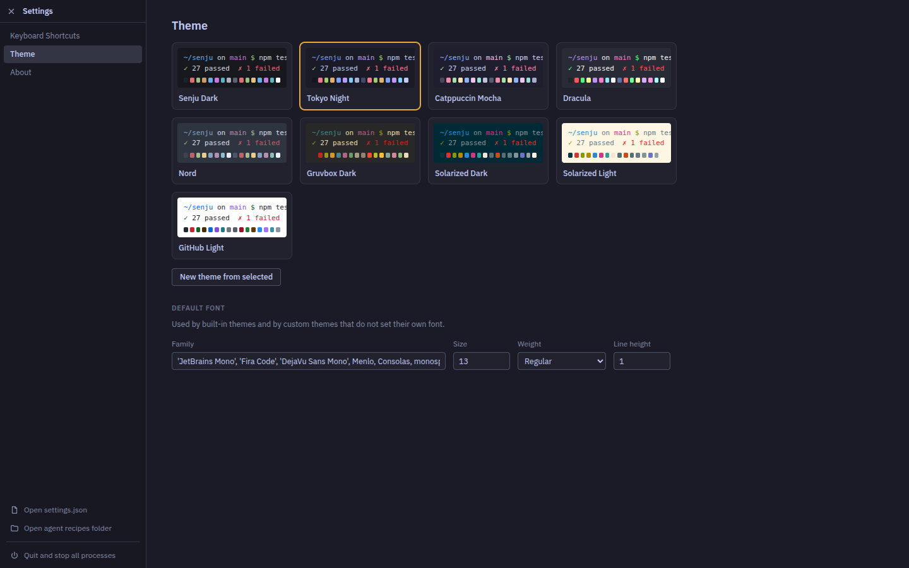
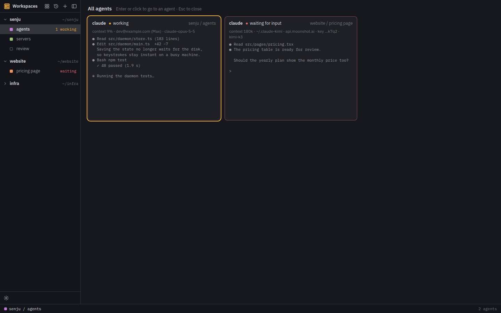
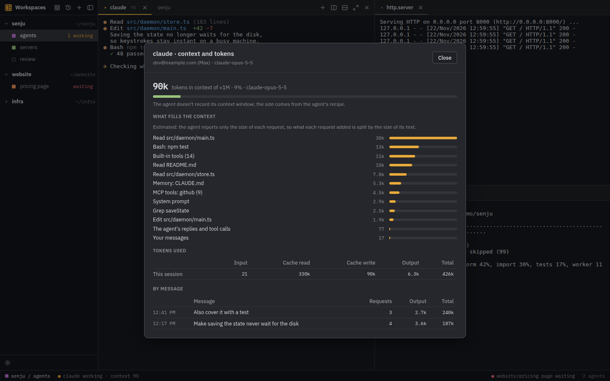

<p align="center"></p>

<h1 align="center">Senju</h1>

<p align="center"><b>The IDE for multitasking in the age of AI.</b><br>
A terminal that keeps many projects and AI agents running side by side — and brings all of them back after a reboot.</p>

<p align="center">
  <a href="LICENSE"></a>
  
  
</p>



Senju (千手, "a thousand hands") is for the way people work with coding agents: one agent refactoring, another writing tests, a dev server and a log in the corner, across several projects at once. It keeps every project in a **group**, every task in a **workspace**, splits each workspace into **panes** with their own **tabs**, and shows at a glance which agents are working and which are waiting for you.

Close the window, crash it, update it or reboot the computer: the layout, the tabs, the working directories and the scrollback come back, and Claude Code and other agents continue the same conversations. Senju is inspired by [cmux](https://github.com/manaflow-ai/cmux), keeps only the essentials, and treats Linux as a first-class platform.

## Features

**Organise many projects and agents**

- Groups in the sidebar, one per project, each with a list of workspaces and its own default folder.
- Workspaces split horizontally and vertically into panes with any nesting; every pane has its own tabs.
- Maximize a pane to read it over the whole workspace (the button in its tab bar, its context menu or the shortcut), and restore it the same way; moving the focus to another pane restores it too.
- Colors for workspaces, drag and drop for groups, workspaces and tabs (also between panes), inline renaming.
- Close a group you are not working on (**Close Group** in its context menu): its processes stop and it is saved to disk. Reopen it from the clock button at the top of the sidebar, and it comes back at its place with its workspaces, layout and scrollback, agents resuming their sessions as after a reboot. **Save Group As…** writes a group to a `.senju` file, and **Open Group from File…** in the same menu opens one as a new group, e.g. on another computer.
- Several windows, each with its own groups: open an empty one with Ctrl+Shift+O (Cmd+Shift+O), or move a group to a new or another window with **Move to Window** in its context menu. A single tab moves the same way, from the menu of its tab, or by dragging it onto a tab bar of another window; its program keeps running. Senju opens every window again with its groups, place and size. Closing a window while others are open moves its groups to the end of the window you used before it; their processes keep running.
- A collapsible sidebar that shrinks to a rail of workspace markers, with the button that expands it and a **⋯** menu for new groups, all agents, closed groups and settings.

**See what your agents are doing**

- Claude Code reports exactly what it is doing: **working** (with the tool call in progress, e.g. `Bash: npm test` or `Edit src/app.ts`, in the tab's tooltip and on its card in **All agents**), **needs permission**, **has a question**, **in background** when it ended its turn but waits for a background command, subagent or scheduled wakeup and goes on by itself when it fires (the tooltip lists what it waits for and the status shows for how long; when the commands it waits for have no process left, it counts as finished), **finished**, **stopped** when you interrupted it, or **failed** when the turn ended with an error such as a rate limit. Senju gets this from Claude Code's hooks through a plugin it passes to each terminal in `CLAUDE_CODE_PLUGIN_DIRS` (Claude Code 2.1.280 or later); your own Claude Code settings are not changed, and outside Senju the plugin is not loaded.
- Other agents, and Claude Code before it reports anything, are marked **working** while they print output and **waiting** once they have been quiet for a second and a half. What they show in reply to your typing or a resize does not count as work.
- Amber means working, red that an agent needs you, green that it finished, blue that it waits for its background work. The sidebar shows the state per workspace, tabs mark it with ▸, and the status bar keeps to totals: how many agents wait for you and how many run in all, so many agents never crowd out the rest of it.
- When an agent you are not looking at needs you (it asks for permission, has a question, finished or failed), Senju shows a system notification; click it to go to that agent. The window title and the app icon (macOS dock, Linux launchers that support it) count the agents waiting for you until you look at them. Turn them off, or pick which of these to be notified about, in **Settings → Notifications**.
- Waiting agents form a queue: Ctrl+Shift+J (Cmd+J) goes to the one that has waited longest, and pressing it again walks on to the next. The status bar shows how many wait and the longest wait (`3 waiting · longest 12m`; click it to go there).
- **How full each agent's context is** shows on its tab (`42%`; amber from 60%, red from 85%) and on its card in **All agents**. Click it, press Ctrl+Shift+K (Cmd+Shift+K), or pick **Context and Tokens…** in the terminal's menu to see [what fills the context and what the agent used](#context-and-tokens).
- **All agents** (Ctrl+Shift+A, Cmd+Shift+A on macOS, the grid button at the top of the sidebar, or the agent count in the status bar) shows every agent as a card with its status, what it is doing, [what it runs with](#context-and-tokens), how full its context is and the last lines of its screen, live, the ones waiting for you first. Click a card or press Enter on it to go to that agent; arrows move between cards and Esc closes the overview.

**See what your agents made**

- An agent shows you a report, a plan, data, a page or an image in a tab next to its terminal: Markdown as a document, JSON and YAML as trees you can fold, CSV as a table, HTML with its scripts running but nothing loaded from the network, images, and code highlighted by language. The tab reloads whenever the file changes, so an agent can keep improving what you look at, wherever you moved the tab. [How agents use it](#viewers).
- Claude Code gets the tools for this automatically, through Senju's MCP server in the plugin it already loads. Any other agent, and you, use the `senju` command that every terminal of Senju has: `senju open report.md`, or `… | senju show -f json`.
- Open any file yourself with Ctrl+Shift+P (Cmd+O) or **Open File…** in a terminal's menu, move a viewer to a window of its own with the button in its bar, and back to its tab or to another window from there.

**Never lose a session**

- Terminals live in a background service, so closing or updating the window does not stop them.
- After a reboot, groups, workspaces, layout, tabs, working directories and scrollback are restored.
- Agents resume their own sessions — Claude Code with `claude --resume <id>`, one session per tab, even with several agents in one folder. Recipes for Codex CLI, Gemini CLI, Antigravity CLI (`agy`), OpenCode, Aider and Neovim sessions are included as well (less tested than Claude Code so far), and new agents are added with a small JSON [recipe](#agent-recipes).
- Dev servers, log followers and monitors start again on their own; any other command offers a **Run again** button.

**Make it yours**

- Nine built-in themes plus your own, with every terminal color and the font editable and a live preview.
- Every keyboard shortcut can be changed, and the defaults never take keys that vim, tmux or an agent need.
- Menus, dialogs and pickers are drawn by the app, so the whole window follows the theme.

<table>
  <tr>
    <td width="50%"><br><sub>Every theme styles the whole window, light ones included.</sub></td>
    <td width="50%"><br><sub>Built-in themes, custom themes and fonts.</sub></td>
  </tr>
  <tr>
    <td width="50%"><br><sub>Every shortcut can be changed.</sub></td>
    <td width="50%"><br><sub>Workspace colors and context menus.</sub></td>
  </tr>
  <tr>
    <td colspan="2"><br><sub>All agents, with the configuration, account or API and model each one runs with.</sub></td>
  </tr>
  <tr>
    <td colspan="2"><br><sub>What fills an agent's context and the tokens of each message.</sub></td>
  </tr>
</table>

## Install

On Linux and macOS, run:

```sh
curl -fsSL https://raw.githubusercontent.com/illerax/senju/main/install.sh | sh
```

The script installs the latest [release](https://github.com/illerax/senju/releases/latest) without root access, and running it again updates Senju:

- **Linux** (x86_64): the AppImage goes to `~/.local/bin/senju`, with an entry in the applications menu. AppImages need FUSE 2 (`sudo apt install libfuse2t64` on Ubuntu 24.04+).
- **macOS** (Apple silicon and Intel): `Senju.app` goes to `/Applications`. The app is not code-signed yet; the script clears the quarantine flag so macOS opens it.

Pass options after `sh -s --`: `--version 0.1.1` installs a given version, `--uninstall` removes the app. Neither touches your settings, state or running terminals.

You can also download the installers from the [releases page](https://github.com/illerax/senju/releases/latest): the AppImage or a deb package for Linux, a dmg for macOS, and an installer for Windows.

## Building from source

You need:

- **Node.js 22** or newer
- a **C/C++ toolchain** for [node-pty](https://github.com/microsoft/node-pty): `build-essential` and `python3` on Debian/Ubuntu, the Xcode command line tools on macOS, Visual Studio Build Tools on Windows

Run it:

```sh
git clone <this repository>
cd senju
npm install
npm start
```

Build installable packages — AppImage and deb on Linux, dmg on macOS, an NSIS installer on Windows — into `release/`:

```sh
npm run dist
```

> **Note for Ubuntu 24.04 and later.** These releases restrict the user namespaces Electron's sandbox needs, so `npm start` runs Electron with `--no-sandbox`. To run from source with the sandbox, give its helper the expected permissions and start with `npx electron .`:
>
> ```sh
> sudo chown root node_modules/electron/dist/chrome-sandbox
> sudo chmod 4755 node_modules/electron/dist/chrome-sandbox
> ```

## Using Senju

Create a group with **+** at the top of the sidebar; it starts in your home folder with one workspace. The path next to a group's name is where its new workspaces open — change it with **Change Default Path…** in the group's context menu. Add workspaces with the **+** that appears on the group's row.

- Each pane's tab bar has buttons to add a tab, split the pane right or down, and close the pane with all its tabs. New tabs and splits start in the folder of the terminal they come from.
- Double-click a group, workspace or tab to rename it. A tab without a name shows its running program or folder.
- Right-click a workspace for its **Color**, a group for its folder, a terminal for copy, paste and splits.
- A workspace's color frames its terminals and tints their tab bars, so you see which workspace you are in at a glance.
- Drag the line between panes to resize them.
- Ctrl+mouse wheel (Cmd+wheel or a pinch on macOS) zooms the text of the tab under the pointer; so do the tab zoom shortcuts below for the focused tab. Other shortcuts zoom all terminals, and a tab's own zoom adds to that. While the focused tab is zoomed, the status bar shows its zoom; click it to return the tab to the font's own size. A terminal's context menu has **Reset Tab Zoom** and **Reset Zoom of All Terminals**. Both zooms are kept across restarts.
- Select text with the mouse; on Linux it also goes to the primary selection, and a middle click pastes it. Ctrl+click (Cmd+click on macOS) opens a link in the browser, including links that programs print with a different text (OSC 8 hyperlinks); hovering one shows its address.
- Ctrl+Shift+F (Cmd+F on macOS) or **Find…** in a terminal's context menu searches the tab's whole scrollback, starting from the selected text. Every match is highlighted; Enter and Shift+Enter step through them, **Aa** matches case, **.\*** takes a regular expression, and Escape closes the search.
- Ctrl+Shift+Space (Cmd+Shift+Space on macOS) or **Copy Mode** in a terminal's context menu selects and copies text with the keyboard alone, from the screen or the scrollback. A cursor appears; a bar at the bottom of the terminal lists the keys, as you set them. By default: h j k l or the arrows move, w and b go by words, 0 and $ (Home, End) to the ends of a line, PageUp and PageDown by pages, g and G to the top and the bottom. v starts selecting, V selects whole lines, / finds text and n and N step through the matches. y or Enter copies the selection, or the cursor's line without one, and leaves copy mode; Escape or q leaves without copying. No key reaches the program in the terminal meanwhile, so an agent's output can be copied while it works.
- Exiting a shell closes its tab; the last tab closes its pane, and the last pane its workspace.
- A tab can also be a [viewer](#viewers) of a file: renamed, moved, zoomed and closed like a terminal's tab.

Closing the last window only closes the UI: every terminal keeps running and is there, in every window, when you open Senju again. To stop everything, use **Quit and stop all processes** at the bottom of the settings; the next start restores the terminals as after a reboot. **Restart background service** in **Settings → About** stops the service and starts it again right away, for when it misbehaves or still runs an older build; terminals come back the same way.

### Keyboard shortcuts

Change any of them in **Settings → Keyboard Shortcuts** (the gear at the bottom of the sidebar), where each group of shortcuts, copy mode keys among them, has its own page.

| Action | Linux, Windows | macOS |
| --- | --- | --- |
| New group | Ctrl+Shift+G | Cmd+Shift+N |
| Next / previous group | Ctrl+Shift+End / Home | Cmd+Ctrl+Down / Up |
| New workspace in the current group | Ctrl+Shift+N | Cmd+N |
| Next / previous workspace, across groups | Ctrl+Shift+PageDown / PageUp | Cmd+Shift+Down / Up |
| Move workspace down / up, into the next or previous group at the ends | Ctrl+Alt+Shift+PageDown / PageUp | Cmd+Alt+Shift+Down / Up |
| Split right / down | Ctrl+Shift+D / E | Cmd+D / Cmd+Shift+D |
| Close pane with its tabs | Ctrl+Shift+X | Cmd+Shift+W |
| Maximize or restore the pane | Ctrl+Shift+Enter | Cmd+Shift+Enter |
| Next / previous pane | Ctrl+Shift+] / [ | Cmd+] / [ |
| Focus pane in a direction | Ctrl+Shift+Arrows | Cmd+Alt+Arrows |
| Go to the agent waiting longest, then the next | Ctrl+Shift+J | Cmd+J |
| Show or hide all agents | Ctrl+Shift+A | Cmd+Shift+A |
| New terminal tab | Ctrl+Shift+T | Cmd+T |
| Close tab | Ctrl+Shift+W | Cmd+W |
| Open a file in a viewer tab | Ctrl+Shift+P | Cmd+O |
| Rename tab | Ctrl+Shift+R | Cmd+Shift+R |
| Next / previous tab | Ctrl+Tab / Ctrl+Shift+Tab | Ctrl+Tab, Cmd+Shift+] / [ |
| Tab 1–9 | Ctrl+Shift+1…9 | Cmd+1…9 |
| Find in the terminal | Ctrl+Shift+F | Cmd+F |
| The agent's context and tokens | Ctrl+Shift+K | Cmd+Shift+K |
| Copy / paste | Ctrl+Shift+C / V, Shift+Insert | Cmd+C / V |
| Copy mode | Ctrl+Shift+Space | Cmd+Shift+Space |
| New window | Ctrl+Shift+O | Cmd+Shift+O |
| Show / hide the sidebar | Ctrl+Shift+B | Cmd+B |
| Settings | Ctrl+Shift+, | Cmd+, |
| Zoom the tab in / out | Ctrl+Shift+= / - | Cmd+= / - |
| Reset the zoom of the tab | Ctrl+Shift+0 | Cmd+0 |
| Zoom all terminals in / out | Ctrl+Alt+Shift+= / - | Cmd+Alt+= / - |
| Reset the zoom of all terminals and tabs | Ctrl+Alt+Shift+0 | Cmd+Alt+0 |

"Close workspace" has no default shortcut. Switching to another group returns to the workspace you last used there.

### Viewers

A viewer shows a file next to the terminal it was opened from: in another pane that shows a viewer, or in a new pane to the right of the terminal (below a tall one). The focus stays in the terminal, so you can go on talking to the agent. Asking again for a file that is open brings its tab to the front, wherever it is now.

| Format | Shown as |
| --- | --- |
| Markdown (`.md`) | a document, code blocks highlighted, links open in the browser |
| JSON, JSONC, YAML | a tree; the top two levels open, a click opens or closes a node, the context menu copies a node's path (`.agents.claude`) or value |
| CSV, TSV | a table |
| HTML | the page, its scripts running in a sandbox; it loads nothing from the network or your disk |
| PNG, JPEG, GIF, WebP, SVG… | the image, fitted; a click shows its actual size |
| Source code, diffs, logs | text with line numbers, highlighted by language |

**Source** in the viewer's bar shows the file as it is; files larger than 5 MB show their start. A viewer reloads within a second of the file changing, keeping its scroll position and the tree nodes you opened. The button at the right end of the bar moves the viewer to a window of its own. There, the same place has a button that returns it to a tab: in the pane it came from, or next to the terminal that showed it when that pane is gone; closing the window closes the viewer. Like any tab, a viewer moves to another window with **Move to Window** in its tab's menu (or the viewer's, in its own window) or by dragging its tab. Wherever it goes, it keeps reloading its file.

**Agents.** Every terminal of Senju has the `senju` command:

```sh
senju open report.md                 # one or more files
senju open --name "Test run" out.json
cargo test --message-format json | senju show -f json   # what is piped in
senju open --window chart.html       # in a window of its own
```

`--format` (`-f`) takes `markdown`, `json`, `yaml`, `html`, `csv`, `image`, `text` or a language such as `python` or `diff`; without it, the extension tells. Content that is piped in is kept by Senju until its tab is closed, and goes with a closed or exported group. Content shown again with the same `--name` from the same terminal replaces what that tab shows instead of opening another, so an agent can update a report it never wrote to a file.

Claude Code gets the same as MCP tools, `show_file` and `show_content`, from the plugin Senju passes to it, so asking it to "show the report in Senju" is enough. Each call answers with the tab's id; passing it back as `id`, or using the same `name`, updates that tab in whatever pane or window you moved it to. Other agents can run the command, or `senju mcp` as an MCP server over stdio: add it to the agent's MCP configuration (Codex: `codex mcp add senju -- senju mcp`, Antigravity CLI: `agy mcp add senju senju mcp`), or tell it about the command in its instructions (`AGENTS.md`). The tools only work in terminals of Senju; elsewhere they say so.

### Context and tokens

**What an agent runs with** shows on its card in **All agents**, in its tab's tooltip and at the top of its usage window, so agents started with different settings are told apart: the configuration folder when it isn't the default one (`CLAUDE_CONFIG_DIR`, `CODEX_HOME`), the account it is signed in to with its plan, the API it talks to when that isn't the agent's own (`ANTHROPIC_BASE_URL`, e.g. `api.moonshot.ai` for Kimi behind Claude Code, Amazon Bedrock, Google Vertex AI, a Codex `model_provider`), the last four characters of its API key, and its model: the one it answered with, or until then the one it is set to (`--model`, `ANTHROPIC_MODEL`, the configuration's settings). Senju reads these from the agent's environment and command line and from its configuration folder (`settings.json` and `.claude.json` of Claude Code, `config.toml` and `auth.json` of Codex); keys and tokens themselves never leave the background service.

Senju reads the session files Claude Code and Codex write — the same ones they resume from — so it knows the tokens of every request the agent made. The window an agent's tab opens shows:

- **The context**: its size at the last request and how much of the model's window that is, and when it was compacted. Codex records its window; for Claude Code the size comes from the model, as listed in the recipe (1M for Opus 5 and `[1m]` models, 200k for others; a larger context seen proves a 1M window).
- **What fills it**: the system prompt, built-in tools, the tools of each MCP server, memory files (`CLAUDE.md`), the skills list, each file the agent read, each command's output, the agent's own replies and your messages. The agents report only the total of each request, so Senju splits what each request added among what came in since the last one, by the size of its text: an estimate, close for large parts. Claude Code's own `/context` gives the exact split.
- **Tokens used**: input, cache reads, cache writes and output of the session, its subagents included; of all sessions of the tab (after `/clear`, say); and of every agent session of the workspace, closed tabs included, so a workspace per task shows what the task cost.
- **By message**: each of your messages with its requests and tokens.

Senju shows tokens, not money: the agents' formats don't record prices, and a subscription is not billed per token. Session files are read where the agents keep them and only as they grow; nothing leaves the machine. Other agents show no usage yet; a recipe can add it when the agent records its tokens in a format Senju reads (`usage` below).

### Themes and fonts

**Settings → Theme** offers Senju Dark, Tokyo Night, Catppuccin Mocha, Dracula, Nord, Gruvbox Dark, Solarized Dark and Light, and GitHub Light. **New theme from selected** copies the current theme into a custom one, where the background, foreground, cursor, selection and all 16 ANSI colors can be edited, and where the theme can have its own font: family, size, weight and line height. The default font on the same page is used by every theme that has none of its own. The family field takes any CSS font list; the arrow next to it lists your installed monospace fonts.

## How restore works

The terminals run in a background service, not in the window. It saves the workspace structure to a small JSON file after every change and each terminal's scrollback to a file of its own every 15 seconds (every minute for terminals that keep printing, and always on shutdown), always atomically, so a crash or power loss never corrupts them.

The structure — groups, workspaces, layout, tabs, focus, folders and scrollback — always comes back. Running programs come back at the best of three levels:

1. **The process keeps running.** Closing or updating the window does not touch the service, so programs simply continue. This does not survive a reboot.
2. **The agent resumes its session.** An agent recognised by a recipe starts again with its session, keeping its options (but not an initial prompt) and its environment, such as `CLAUDE_CONFIG_DIR`. Several agents in one folder each get their own session back. An agent you closed yourself stays closed.
3. **The command starts again** in the same folder with the same environment. Commands matching the `autoRestart` list (dev servers, `tail -f`, log followers, monitors) restart on their own; others show a **Run again** button.

A group closed to disk and reopened comes back the same way, as after a reboot.

When Senju is updated while the service is still running the previous version, a banner offers **Restart service**, which applies the update and restores the terminals as after a reboot.

## Updates

Installed builds look for a new release at start and every four hours (turn this off in **Settings → About**). When one appears, a banner offers **Download and install**; nothing is downloaded or installed until you agree. Once it is downloaded, **Restart and install** replaces the app and starts the new version, or it is installed the next time you quit.

- Your settings, state and scrollback live in your own folders (see [Configuration](#configuration)), so an update never touches them; older state files are migrated.
- Running terminals keep running: the background service is not stopped by the update. On Windows, macOS and for the AppImage it runs from its own copy of the app, outside the install folder, because the Windows installer closes a running Senju, an AppImage disappears when it is replaced, and a replaced app on macOS would hand the service the new version's files. After the update the new version reconnects to the service; if the service runs an older build, a banner offers to restart it when it suits you.
- If a new version cannot work with the running service at all, Senju asks before restarting it, and you can keep the old version running instead.
- AppImage, macOS and the Windows installer update themselves; the deb package asks for your password to install. The macOS app is not code-signed, so it does what the install script does: it downloads the disk image, copies the new app next to the installed one and swaps them. When Senju cannot replace itself — macOS runs it from a temporary copy (open it from Applications instead) or its folder is not writable — the banner opens the release page.

## Configuration

Settings live in `settings.json`, which holds only what differs from the defaults (**Open settings.json** at the bottom of the settings). Every key is optional:

| Key | Default | Description |
| --- | --- | --- |
| `fontFamily`, `fontSize`, `fontWeight`, `lineHeight` | JetBrains Mono, 13, 400, 1 | Default terminal font. |
| `zoom` | `0` | Pixels added to the font size of every terminal by zooming all terminals; a tab's own zoom is kept with the workspaces. |
| `notifications` | `true` | A system notification when an agent you are not looking at needs you. |
| `notifyOn` | all `true` | Which reasons to notify about: `permission`, `question`, `finished`, `failed`, `input` (agents without hooks that went quiet), e.g. `{ "finished": false }`. |
| `theme` | `Senju Dark` | Name of a built-in or custom theme. |
| `themes` | `{}` | Custom themes by name: `background`, `foreground`, `cursor`, `selectionBackground`, the 16 ANSI colors (`black` … `brightWhite`) and optionally `font`. |
| `keybindings` | `{}` | Shortcuts that differ from the defaults, e.g. `{ "newTab": ["Ctrl+Alt+T"] }`; an empty list unbinds a command. |
| `shell`, `shellArgs` | `$SHELL` (PowerShell on Windows) | Shell for new terminals. macOS starts a login shell by default. |
| `scrollback` | `10000` | Lines kept per terminal while running. |
| `persistedScrollback` | `5000` | Lines saved per terminal and restored after a reboot. |
| `autoRestart` | dev servers, log followers, monitors | Regular expressions for command lines that restart automatically after a reboot. |
| `copyOnSelect` | `false` | Copy selected text to the clipboard. |

Changes in the settings page apply right away; edits to the file apply when the app starts. `shell`, `scrollback`, `autoRestart` and recipes are read by the background service when it starts.

| | Linux | macOS | Windows |
| --- | --- | --- | --- |
| Settings, recipes | `~/.config/senju/` | `~/Library/Application Support/Senju/` | `%APPDATA%\Senju\` |
| State, scrollback, log | `~/.local/state/senju/` | same as above | same as above |

`SENJU_HOME` replaces all of these with one folder, which is handy for testing.

### When Senju is slow or fails

`diagnostics.log` in the state folder records, one JSON object per line:
- each start of the app and of the background service, with the system they run on: version, OS, desktop session, CPU, memory, displays, GPU and whether drawing is accelerated, and the font settings;
- slow moments as they happen: the window not drawing or not responding (`no frames`, `blocked`, `long task`, `window not responding`), a slow switch between tabs, panes or workspaces, a terminal whose output piles up faster than it is drawn, the background service or the main process being blocked, or a terminal printing a burst of output;
- errors in the window, the main process and the background service, and crashed processes.

Each slow moment lists what happened in the seconds before and the terminals that printed the most, named by their tab; every entry carries the system load and free memory. The log holds no terminal contents, commands, user names or host names. **Show diagnostics.log** on the About page of the settings opens its folder; attach the file when reporting a hang or an error (**Report a problem** opens a new issue).

Logs don't grow without bound: a log over a megabyte moves to `diagnostics.log.1` (or `daemon.log.1`), replacing the previous one, so each takes at most two megabytes. `daemon.log` holds the background service's own messages, including the commands it restores terminals with; it is not meant to be sent.

## Agent recipes

A recipe tells Senju how to recognise an agent, how to find its session id and how to reopen it. The built-in ones are in [`recipes/`](recipes). To add an agent or change a built-in one, put a JSON file into the recipes folder (**Open agent recipes folder** at the bottom of the settings); a recipe with the name of a built-in one replaces it.

```json
{
  "name": "claude-code",
  "match": "^claude$|@anthropic-ai/claude-code",
  "session": {
    "args": ["(?:--resume|-r|--session-id)[ =]([0-9a-f-]{36})"],
    "pidFile": { "file": "${env:CLAUDE_CONFIG_DIR:-~/.claude}/sessions/${pid}.json", "field": "sessionId" },
    "files": { "dir": "${env:CLAUDE_CONFIG_DIR:-~/.claude}/projects/${cwdSlug}", "pattern": "^([0-9a-f-]{36})\\.jsonl$" }
  },
  "flags": { "drop": ["--resume", "-r", "--continue", "-c"], "withValue": ["--resume", "-r", "--model"] },
  "resume": "claude ${flags} --resume ${sessionId}",
  "fallback": "claude ${flags} --continue"
}
```

| Field | Meaning |
| --- | --- |
| `match` | Regular expression for the program name or path. Programs run by an interpreter (`node`, `python`, …) are matched by their script. |
| `requires` | A file relative to the working folder that must exist, e.g. `Session.vim`. |
| `session.args` | Regular expressions over the arguments; group 1 is the session id. |
| `session.pidFile` | A JSON file the agent writes per process; `field` holds the session id. The most precise source. |
| `session.openFile` | A regular expression over the paths of the files the agent process keeps open; group 1 is the session id. As precise as `pidFile`, on Linux and macOS: Antigravity CLI keeps `presence/<conversation>.lock` open. |
| `session.files` | A folder with one file per session; `pattern` group 1 is the id. Options: `recursive`, `newestDirs` (only the last N subfolders by name) and `contains` (text that must appear at the start of the file). Used when neither of those names the session: each terminal takes the newest unclaimed session file written after its agent started. |
| `flags` | Which original options `${flags}` carries over: everything starting with `-` except `drop`; `withValue` lists options followed by a separate value. Positional arguments are never carried over. |
| `resume` | Command for a known session. |
| `fallback` | Command when the session id is unknown. |
| `usage` | How to read the context and tokens from the session files: `format` (`claude-code` or `codex`) and, for agents that don't record their context window, `contextWindows`: a list of `{ "model": <regular expression>, "tokens": <size> }`, the first match wins. |

Templates understand `${sessionId}`, `${flags}`, `${args}`, `${program}`, `${cwd}`, `${cwdSlug}` (the folder with every non-alphanumeric character replaced by `-`), `${cwdJson}`, `${pid}`, `${home}`, `${env:NAME}` and `${env:NAME:-default}`; a leading `~` is the home folder.

## Platform notes

- **Linux** (X11 and Wayland) is the primary platform and supports everything above.
- **macOS** supports everything, except that a program's environment cannot be read, so restored programs get the shell's environment.
- **Windows** does not expose a terminal's foreground program or folder, so programs are not resumed or restarted after a reboot; the layout, tabs and scrollback are restored, and terminals start in their initial folder.

## Development

```sh
npm run build        # bundle into dist/
npm run typecheck
npm test             # unit tests
npm run test:daemon  # end-to-end test of the background service: terminals, jobs, agents, restore
npm run test:ui      # drives the app with Playwright and saves screenshots to ui-smoke/
npm run test:perf    # keystroke latency under heavy output, switching times
npm run test:network # a network share and an update server on a bad connection (Linux, needs fusermount3)
npm run screenshots  # regenerates the README screenshots in docs/screenshots/
npm run icons        # renders build/icon.svg into the app icons
node scripts/update-e2e.mjs <old.AppImage> <dir>  # self-update test, see the script
```

The code is split by process:

- `src/daemon` — the background service: owns the pseudo terminals (node-pty), mirrors each into a headless xterm for scrollback, tracks folders, programs and agent sessions, and saves the state.
- `src/main` — the Electron main process: starts or connects to the service and relays messages.
- `src/renderer` — the UI: sidebar, pane layout, tabs, xterm.js terminals, settings, menus and dialogs.
- `src/cli` — the `senju` command and its MCP server, run in terminals with Electron as Node.
- `src/shared` — state types, the protocol, layout operations, commands, settings and themes.
- `recipes` — built-in agent recipes.

## Releases and versioning

Releases follow [semantic versioning](https://semver.org). The version is decided by what someone who updates notices, not by how big the change is:

| Bump | When | Examples |
| --- | --- | --- |
| **major** | Something stops working as before without the user doing anything | `state.json` from an older version is not read and has no migration; a `settings.json` key or the recipe format changes incompatibly; a feature or platform is removed; a default shortcut people rely on changes |
| **minor** | Something new, and everything old works as before | a new command, setting, theme or agent recipe; a new state field with an automatic migration; a protocol change that makes the update restart the background service |
| **patch** | Fixed or faster, nothing new | a bug fix, a performance gain, layout or wording |
| none | Nothing reaches users | tests, CI, refactoring, documentation |

While the version is below 1.0, a breaking change bumps the minor version and a feature the patch version; a release with large features (several of them, or one that changes how Senju is used) bumps the minor version too, set with a `Release-As: 0.x.0` line at the end of a squash commit's message. 1.0.0 is released by hand once the data and settings formats are stable.

The bump is computed from [Conventional Commits](https://www.conventionalcommits.org). Pull requests are squash-merged, so the PR title is the commit message, and CI checks it:

- `feat: …` → minor, `fix: …` and `perf: …` → patch
- `feat!: …`, or a `BREAKING CHANGE:` paragraph in the PR description → major
- `docs:`, `test:`, `ci:`, `build:`, `refactor:`, `chore:`, `style:` → no release

After each merge, [release-please](https://github.com/googleapis/release-please) updates a `chore: release x.y.z` pull request with the new version and changelog. Merging it tags the version, creates the GitHub release and attaches the installers for Linux (AppImage, deb), macOS (dmg, Apple silicon and Intel) and Windows (installer), built by CI. The release stays a pre-release until all installers are attached, so installed apps and the install command only see it once there is something to install. The installers are not code-signed yet, so macOS and Windows warn on first start.

## License

[MIT](LICENSE)
